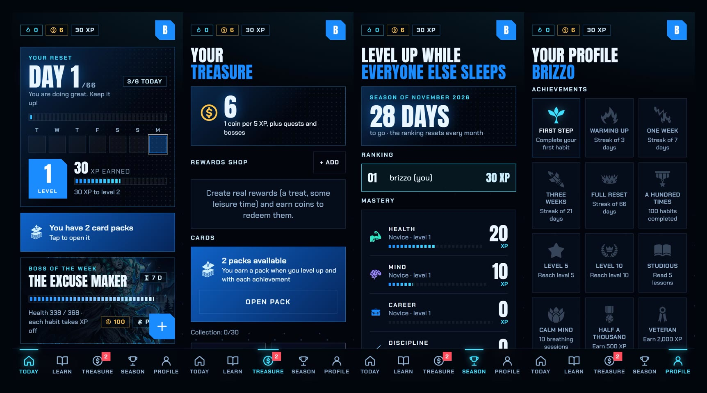

[English](README.md) · **Español**

<h1 align="center">RESET</h1>
<p align="center"><b>Reinicia tu vida en 66 días.</b><br>Un gestor de hábitos gamificado que alojas tú. Estética oscura, azul eléctrico, estilo anime y HUD. Funciona sin conexión, se instala como una app y lee los datos de tu móvil o reloj.</p>

<p align="center"></p>

> Se dice que un hábito tarda unos 66 días en asentarse. Reset convierte esos 66 días en un juego: cada hábito que completas da XP, crea rachas, quita vida a un jefe semanal y desbloquea cartas, y tus datos se quedan en **tu** servidor.

## Características

**Hábitos y progreso**
- Hábitos diarios con rachas, dificultad, recordatorios, días de salto y hábitos a dejar.
- XP, niveles y **maestría por áreas de la vida** (Salud, Mente, Carrera, Disciplina, Relaciones, Aprendizaje, Espíritu).
- Contador del programa de 66 días, **calendario de calor** y estadísticas semanales.
- Hábitos iniciales generados con un breve cuestionario.

**Gamificación**
- **Jefe semanal** (8 distintos): cada hábito completado le quita vida.
- **Misiones diarias**, monedas y una **tienda de recompensas** donde creas premios reales ("un capítulo de mi serie") y los canjeas.
- **Packs de cartas** comunes, raras, épicas y legendarias, con animación al abrirlos.
- **Logros** (25) y **temporadas** mensuales con ranking entre las personas de tu servidor.

**Aprende y relájate**
- Lecciones cortas sobre cómo funcionan los hábitos (+XP) y sesiones de **respiración guiada**.

**Datos de salud (móvil y reloj)**
- **Lee tu cuenta de Zepp directamente** (pasos, distancia, sueño, pulso en reposo, entrenamientos), o lee Apple Health / Health Connect mediante una app puente (los relojes Samsung funcionan así).
- Los hábitos con **regla automática** ("caminar 8.000 pasos", "dormir 7 h") se completan solos al llegar al objetivo.

**Alojado por ti y privado**
- Un contenedor Docker, Node + SQLite, sin servicios externos, sin rastreo ni analíticas.
- **PWA que funciona sin conexión**: marca hábitos sin red, se sincroniza después, se instala en iPhone y Android.
- **Recordatorios push**, invitaciones para amistades, exportación de tus datos en JSON y borrado de la cuenta.
- Interfaz en **inglés y español** y opciones de accesibilidad (tamaño de texto, menos animaciones).

## El reparto

<p align="center">


</p>
<p align="center">


</p>

## Arrancar

Con Docker:

```bash
docker compose up -d --build
```

Copia `.env.example` a `.env` y ajústalo (`COOKIE_SECURE=1` si lo sirves por HTTPS). Por defecto el puerto solo escucha en `127.0.0.1`: publícalo con Tailscale o un proxy, o pon `BIND=0.0.0.0` para usarlo en tu red local.

Abre `http://localhost:3000`. El primer usuario que se registra entra directamente y pasa a administrar la app. Esa
persona puede invitar a otras desde **Perfil → Administración → Crear invitación**: cada código sirve una sola vez y
caduca a los 7 días. Todo el mundo puede, desde Perfil, cambiar su contraseña, descargar sus datos en JSON o eliminar
su cuenta.

Si prefieres un código fijo para todos, define uno antes de arrancar:

```bash
INVITE_CODE=un-codigo-largo docker compose up -d
```

Sin Docker (Node 24 o superior):

```bash
npm install
npm start
```

## Variables de entorno

| Variable | Qué hace | Por defecto |
|---|---|---|
| `PORT` | Puerto del servidor | `3000` |
| `DATA_DIR` | Dónde se guardan la base de datos y las claves push | `./data` (`/data` en Docker) |
| `INVITE_CODE` | Código para registrar a más personas. Vacío = registro cerrado tras el primer usuario | vacío |
| `COOKIE_SECURE` | `1` si lo sirves por HTTPS (recomendado) | `0` |
| `VAPID_SUBJECT` | Contacto para las notificaciones push (`mailto:tu@correo`) | `mailto:admin@localhost` |

## Idioma

La interfaz sigue el idioma del navegador (español si empieza por `es`, inglés si no) y se cambia en la pantalla de
acceso o en **Perfil → Idioma**. Se guarda por cuenta, así que las notificaciones y los hábitos iniciales también salen
en ese idioma. Cada idioma es un archivo `public/locales/<código>.json` (`strings` y `patterns`); lo que no esté
traducido se ve en español. Para añadir uno: su código en `LANGS` de `public/i18n.js` y en `LANG_CODES` de
`server/server.js`, y su JSON. Para ver qué falta, `localStorage.setItem('reset.debug', '1')` en la consola y
`window.__missing()`. El README en inglés es el principal; este es su copia en español.

## HTTPS y notificaciones

Las notificaciones push y la instalación como app exigen HTTPS (salvo en `localhost`). Pon delante un proxy
(Caddy, Traefik, Nginx) o un túnel (Cloudflare Tunnel) y activa `COOKIE_SECURE=1`. En iPhone hay que añadir la
app a la pantalla de inicio antes de poder activar los recordatorios.

Haz copia de seguridad de la carpeta `DATA_DIR`: contiene `app.db` y `vapid.json` (las claves push; si se pierden,
hay que volver a activar las notificaciones en cada dispositivo).

## Diseño

- Fuentes: Anton y Chakra Petch, alojadas en `public/fonts` (licencia SIL Open Font License). No se contacta con ningún
  servicio externo.
- Ilustraciones en `public/art`: una por área para las tarjetas de hábito (`health`, `mind`, `career`, `discipline`,
  `relationships`, `learning`, `spirit`, en `.webp` de 1280×512, con `default.svg` de respaldo), `login.webp`,
  `levelup.webp`, `pack.webp` (el sobre), `default.webp`, los marcos `card-common.webp`, `card-rare.webp`, `card-epic.webp` y
  `card-legendary.webp` (los dos primeros son apaisados y ocupan dos columnas en la colección) y una imagen por jefe,
  `boss-<nombre-sin-acentos>.webp` (por ejemplo `boss-el-excusas.webp`; `boss.webp` es el respaldo). Para cambiar una, sustituye el
  archivo con el mismo nombre. Los JPG originales están en `assets-src/` (fuera de la imagen de Docker).
- Iconos de la app: `public/icons/`, generados a partir del logo R.
- Colores y formas: variables al principio de `public/styles.css`; los colores de cada área, en `content/templates.json`.
- Contenido propio y editable: `content/lessons.json`, `content/cards.json` y `content/templates.json`.

## Datos de salud

Hay dos caminos. Elige una sola fuente por persona para que los mismos pasos no se cuenten dos veces.

### Opción 1: leer tu cuenta de Zepp directamente

**Perfil → Salud y ejercicio → Conectar Zepp.** Escribe el correo y la contraseña de tu cuenta de Zepp (la de la app
del reloj). El servidor entra y, cada 15 minutos, lee tus pasos, distancia, sueño, pulso en reposo y entrenamientos, y
completa los hábitos con regla automática. Solo lee y no cierra la sesión de Zepp de tu móvil. Sirve con cualquier
reloj que sincronice con Zepp (Amazfit, Zepp OS...).

- **No es oficial.** Zepp no tiene una API pública. Esto usa la misma interfaz sin documentar que su acceso web, así que
  puede dejar de funcionar cuando Zepp la cambie, y puede ir contra sus condiciones de uso. Úsalo solo con tu cuenta.
- **Tu contraseña se guarda en tu servidor**, cifrada con AES-256-GCM con una clave en `DATA_DIR/zepp.key`. Quien pueda
  leer toda la carpeta de datos podría descifrarla. Desconecta Zepp en el mismo panel para borrarla.
- Las cuentas creadas con Google o Apple pueden no funcionar: crea antes una contraseña en la app de Zepp.
- Solo el código de `server/zepp.js` habla con Zepp. `npm test` lo comprueba con un Zepp falso, **no** con el real,
  así que la primera conexión real es la prueba de verdad; si algo falla, el panel muestra el error. Para pruebas,
  `ZEPP_USER_URL` y `ZEPP_API_URL` apuntan a otro servidor y `ZEPP_SYNC_MS` cambia el intervalo.

### Opción 2: a través de Apple Health o Health Connect

Un navegador no puede leer Apple Health ni Health Connect. El camino es este:

1. En la app de tu reloj: **Zepp** (Perfil → Añadir cuentas → Apple Health o Health Connect) o **Samsung Health**
   (Ajustes → Health Connect, en Android), con todos los datos activados. Si usas varios relojes, deja un único origen
   por tipo de dato en Health Connect para que los pasos no se cuenten dos veces.
2. En Reset: **Perfil → Salud y ejercicio → Conectar móvil o reloj → Crear clave de conexión**. La clave se muestra una
   sola vez; en el servidor solo se guarda un resumen irreversible.
3. Una app puente del móvil lee Apple Health o Health Connect y envía los datos a `https://TU-SERVIDOR/api/health/ingest`
   con la cabecera `Authorization: Bearer TU-CLAVE`. En iPhone sirve **Health Auto Export** (automatización de tipo API
   REST, formato JSON); en Android, una app que envíe Health Connect a un webhook propio.

El servidor acepta el JSON de Health Auto Export y este formato sencillo para cualquier otra app:

```json
{ "daily": [{ "date": "2026-11-02", "steps": 8000, "exercise_minutes": 35 }],
  "workouts": [{ "id": "unico-por-entreno", "type": "Running", "start": "2026-11-02T07:30:00+01:00", "minutes": 40, "distance_km": 5.2 }] }
```

Reenviar los mismos datos no los duplica. Se leen pasos, minutos de ejercicio, distancia, calorías activas,
entrenamientos (con su pulso medio y máximo), pulso (medio, mínimo y máximo), pulso en reposo, variabilidad cardiaca,
oxígeno en sangre, sueño, VO₂ máx y respiración; los valores imposibles se descartan. Hoy muestra el resumen del día,
Perfil una gráfica de la semana por métrica, y los hábitos con regla automática (pasos, minutos de ejercicio,
entrenamientos, distancia u horas de sueño) se completan solos al llegar a su objetivo. También puedes añadir entrenamientos a mano. Las claves se revocan desde la misma pantalla.

## Uso sin conexión

La app guarda en el dispositivo una copia de tus datos y funciona sin red (o con el servidor caído o la VPN
apagada). Sin conexión puedes marcar y saltar hábitos, crear, editar y archivar hábitos, leer lecciones y hacer
sesiones de respiración. Los cambios se aplican al instante, se guardan en una cola y se envían solos, en orden, al
volver la conexión; entonces la pantalla se actualiza con los datos reales del servidor. Una barra arriba avisa de
que no hay conexión y de cuántos cambios están pendientes.

- Hay que abrir la app una vez con conexión para que guarde los datos y las pantallas.
- Necesitan conexión: abrir packs de cartas, cobrar misiones y jefe, la tienda, la temporada, el calendario y la
  cuenta. Las que ya se hubieran visto muestran su última copia.
- El servidor admite cambios de hasta 8 días de antigüedad; si pasas más tiempo sin conexión, los más viejos se
  descartan.
- Los reintentos son seguros: enviar dos veces el mismo cambio no duplica XP ni hábitos.
- Con la pantalla de acceso (cerrar sesión, cambiar de cuenta) se borra la copia local.

## Sonidos

Los archivos activos están en `public/sfx/<nombre>.mp3`; si falta alguno, la app usa un sonido sintetizado. Para
escuchar las alternativas y elegir, abre `/sfx-lab.html`. Los candidatos están en `public/sfx/candidates/` y los míos
(sintetizados con `scripts/make-sfx.py`) en `public/sfx/mine/`.

Créditos de los sonidos (todos CC0, la atribución no es obligatoria): [Kenney](https://kenney.nl) (Interface Sounds,
Sci-Fi Sounds e Impact Sounds) y el "Sound Pack 01" de OpenGameArt.

## Iconos

Los iconos de logros, misiones, áreas y lecciones están en `public/icons/game/` y son de
[game-icons.net](https://game-icons.net) (autores: Lorc, Delapouite y otros colaboradores), con licencia
[CC BY 3.0](https://creativecommons.org/licenses/by/3.0/). Esa licencia exige dar crédito, y la app lo hace en
Perfil. Para cambiar uno, cambia su nombre en `server/server.js` (logros y misiones), `content/templates.json`
(áreas) o `content/lessons.json` (lecciones) y pon el SVG con ese nombre en esa carpeta.

## Accesibilidad

En **Perfil → Accesibilidad** hay tres tamaños de texto y un interruptor para reducir las animaciones (además de respetar
el ajuste del sistema). Los diálogos forman una pila: solo responde el de arriba, Escape cierra solo ese, el fondo queda
inerte y el foco vuelve al botón que lo abrió. Los botones táctiles miden al menos 44 px y los laterales respetan las
zonas seguras del móvil.

## Pruebas

```bash
npm test
```

Arranca el servidor con datos temporales y recorre la API (registro, XP, saltos, jefe, misiones, tienda, cartas,
calendario y aislamiento entre usuarios).

## Licencia

El código de la app se publica con la [licencia MIT](LICENSE). Los recursos de terceros mantienen sus propias licencias (ver Iconos y Sonidos).
