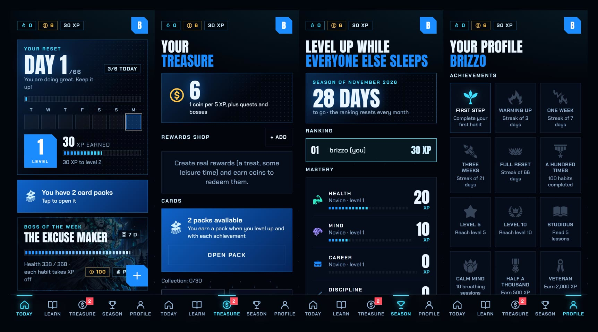

**English** · [Español](README.es.md)

<h1 align="center">RESET</h1>
<p align="center"><b>Reset your life in 66 days.</b><br>A gamified habit tracker you host yourself. Dark, electric-blue, anime-HUD look. Works offline, installs like an app, and reads your phone or watch.</p>

<p align="center"></p>

> Science says a habit takes about 66 days to stick. Reset turns those 66 days into a game: every habit you complete earns XP, builds streaks, damages a weekly boss and unlocks cards, while your data stays on **your** server.

## Features

**Habits and progress**
- Daily habits with streaks, difficulty, reminders, "skip" days and habits to quit.
- XP, levels, and **mastery per life area** (Health, Mind, Career, Discipline, Relationships, Learning, Spirit).
- A 66-day program counter, a **heat-map calendar** and weekly insights (completion by day of the week).
- Starter habits generated from a short onboarding.

**Gamification**
- **Weekly boss** (8 different ones): each habit you complete takes health off the boss.
- **Daily quests**, coins, and a **rewards shop** where you create real rewards ("an episode of my show") and redeem them.
- **Card packs** with common, rare, epic and legendary cards, opened with a pack-opening animation.
- **Achievements** (25), monthly **seasons** with a ranking among the people on your server.

**Learn and calm down**
- Short lessons about how habits work (+XP) and **guided breathing** sessions.

**Health data (phone and watch)**
- Reads steps, exercise minutes, distance, workouts, heart rate, sleep and more from Apple Health / Health Connect through a bridge app (Zepp and Samsung watches work through them).
- Habits with an **automatic rule** ("walk 8,000 steps", "sleep 7 h") complete themselves when you reach the goal.

**Self-hosted and private**
- One Docker container, Node + SQLite, no external services, no tracking, no analytics.
- **Offline-first PWA**: check habits with no connection, changes sync later, installable on iPhone and Android.
- **Push reminders** (Web Push), invitations for friends, export your data as JSON, delete your account.
- **English and Spanish** interface, accessibility options (text size, reduced motion).

## The cast

<p align="center">


</p>
<p align="center">


</p>

## Getting started

With Docker:

```bash
docker compose up -d --build
```

Copy `.env.example` to `.env` and adjust it (`COOKIE_SECURE=1` when you serve it over HTTPS). By default the port is bound to `127.0.0.1` only: publish it with Tailscale or a proxy, or set `BIND=0.0.0.0` to use it on your local network.

Open `http://localhost:3000`. The first user to register gets in directly and becomes the administrator. They can
invite others from **Profile → Administration → Create invitation**: each code works once and expires after 7 days.
Everyone can change their password, download their data as JSON or delete their account from Profile.

If you prefer one fixed code for everybody, set it before starting:

```bash
INVITE_CODE=a-long-code docker compose up -d
```

Without Docker (Node 24 or newer):

```bash
npm install
npm start
```

## Environment variables

| Variable | What it does | Default |
|---|---|---|
| `PORT` | Server port | `3000` |
| `DATA_DIR` | Where the database and the push keys are stored | `./data` (`/data` in Docker) |
| `INVITE_CODE` | Code to register more people. Empty = registration closes after the first user | empty |
| `COOKIE_SECURE` | `1` if you serve it over HTTPS (recommended) | `0` |
| `VAPID_SUBJECT` | Contact for push notifications (`mailto:you@example.com`) | `mailto:admin@localhost` |
| `RATE_LIMIT` | Maximum login/registration attempts per window and IP (raise it for tests) | built in |

## Language

The interface follows the browser language (Spanish if it starts with `es`, English otherwise) and can be changed on
the sign-in screen or in **Profile → Language**. The choice is stored per account, so push notifications and the
starter habits are created in that language too.

The source text of the interface is Spanish. Each language is a file, `public/locales/<code>.json`, with
`{ "strings": { "texto en español": "translation" }, "patterns": [[regex, replacement]] }`. Anything without a
translation is shown in Spanish, so a new language can be added bit by bit: add the code to `LANGS` in
`public/i18n.js` and to `LANG_CODES` in `server/server.js`, then create its JSON file. In a replacement, `$1` inserts a
captured group as is and `$t1` inserts it translated. To find untranslated texts, run
`localStorage.setItem('reset.debug', '1')` in the browser console, use the app, and call `window.__missing()`.

## HTTPS and notifications

Push notifications and installing the app require HTTPS (except on `localhost`). Put a proxy in front (Caddy, Traefik,
Nginx), a tunnel (Cloudflare Tunnel) or Tailscale (`tailscale serve --bg 3000`) and set `COOKIE_SECURE=1`. On iPhone the
app has to be added to the home screen before reminders can be enabled.

Back up the `DATA_DIR` folder: it holds `app.db` and `vapid.json` (the push keys; if they are lost, notifications have
to be enabled again on every device).

## Design

- Fonts: Anton and Chakra Petch, hosted in `public/fonts` (SIL Open Font License). No external service is contacted.
- Illustrations in `public/art`: one per area for the habit cards (`health`, `mind`, `career`, `discipline`,
  `relationships`, `learning`, `spirit`, as 1280×512 `.webp`, with `default.svg` as a fallback), `login.webp`,
  `levelup.webp`, `pack.webp` (the pack), `default.webp`, the frames `card-common.webp`, `card-rare.webp`,
  `card-epic.webp` and `card-legendary.webp` (the first two are landscape and span two columns in the collection) and
  one image per boss, `boss-<name-without-accents>.webp` (for example `boss-el-excusas.webp`; `boss.webp` is the
  fallback). To change one, replace the file with the same name.
- App icons: `public/icons/`, generated from the R logo.
- Colours and shapes: variables at the top of `public/styles.css`; the colour of each area is in
  `content/templates.json`.
- Your own editable content: `content/lessons.json`, `content/cards.json` and `content/templates.json`.

## Health data (phone and Zepp or Samsung watch)

A browser cannot read Apple Health or Health Connect, and Zepp has no public API. The way in is this:

1. In your watch's app: **Zepp** (Profile → Add accounts → Apple Health or Health Connect) or **Samsung Health**
   (Settings → Health Connect, on Android), with all data enabled. If you use several watches, keep a single source per
   data type in Health Connect so steps are not counted twice.
2. In Reset: **Profile → Health and exercise → Connect phone or watch → Create connection key**. The key is shown only
   once; the server stores only an irreversible hash of it.
3. A bridge app on the phone reads Apple Health or Health Connect and sends the data to
   `https://YOUR-SERVER/api/health/ingest` with the header `Authorization: Bearer YOUR-KEY`. On iPhone,
   **Health Auto Export** works (REST API automation, JSON format); on Android, an app that sends Health Connect data to
   your own webhook.

The server accepts the Health Auto Export JSON and this simple format for any other app:

```json
{ "daily": [{ "date": "2026-11-02", "steps": 8000, "exercise_minutes": 35 }],
  "workouts": [{ "id": "unique-per-workout", "type": "Running", "start": "2026-11-02T07:30:00+01:00", "minutes": 40, "distance_km": 5.2 }] }
```

Sending the same data again does not duplicate it. It reads steps, exercise minutes, distance, active calories,
workouts (with average and maximum heart rate), heart rate (average, minimum and maximum), resting heart rate, heart
rate variability, blood oxygen, sleep, VO₂ max and respiration; impossible values are discarded. Today shows the day's
summary, Profile a weekly chart per metric, and habits with an automatic rule (steps, exercise minutes, workouts,
distance or hours of sleep) complete themselves when they reach their goal. You can also add workouts by hand. Keys can
be revoked from the same screen. The response lists the habits completed (`completed_habits`).

## Offline use

The app keeps a copy of your data on the device and works without a network (or with the server down or the VPN off).
Offline you can check and skip habits, create, edit and archive habits, read lessons and do breathing sessions.
Changes apply instantly, are kept in a queue and are sent automatically, in order, when the connection returns; the
screen then refreshes with the server's real data. A bar at the top says there is no connection and how many changes are
pending.

- Open the app once while online so it can store the data and the screens.
- These need a connection: opening card packs, claiming quests and the boss, the shop, the season, the calendar and
  the account. Screens you had already seen show their last copy.
- The server accepts changes up to 8 days old; if you stay offline longer, the oldest ones are discarded.
- Retries are safe: sending the same change twice does not duplicate XP or habits.
- Going to the sign-in screen (logging out, switching accounts) deletes the local copy.

## Sounds

The active files are in `public/sfx/<name>.mp3`; if one is missing, the app uses a synthesised sound. To listen to the
alternatives and choose, open `/sfx-lab.html`. The candidates are in `public/sfx/candidates/` and my own (synthesised
with `scripts/make-sfx.py`) in `public/sfx/mine/`.

## Accessibility

**Profile → Accessibility** has three text sizes and a switch to reduce animations (the system setting is respected
too). Dialogs form a stack: only the top one responds, Escape closes only that one, the background becomes inert and
focus returns to the button that opened it. Touch buttons are at least 44 px tall and the side ones respect the phone's
safe areas.

## Tests

```bash
npm test
```

Starts the server with temporary data and walks through the API (registration, XP, skips, boss, quests, shop, cards,
calendar and isolation between users).

## Credits and licences

- Fonts: Anton and Chakra Petch, [SIL Open Font License](https://openfontlicense.org).
- Icons for achievements, quests, areas and lessons (`public/icons/game/`): [game-icons.net](https://game-icons.net)
  (authors: Lorc, Delapouite and other contributors), [CC BY 3.0](https://creativecommons.org/licenses/by/3.0/). The
  licence requires credit, and the app gives it in Profile. To change one, rename it in `server/server.js`
  (achievements and quests), `content/templates.json` (areas) or `content/lessons.json` (lessons) and put the SVG with
  that name in that folder.
- Sounds: CC0, attribution not required: [Kenney](https://kenney.nl) (Interface Sounds, Sci-Fi Sounds and Impact
  Sounds) and "Sound Pack 01" from OpenGameArt; the rest are synthesised in this repository.
- Illustrations in `public/art` were generated for this project from the prompts in `PROMPTS.md`. If you publish your
  own version, check that the images you use are yours to share.
- The app's own code is released under the [MIT licence](LICENSE). The third-party assets above keep their own licences.
